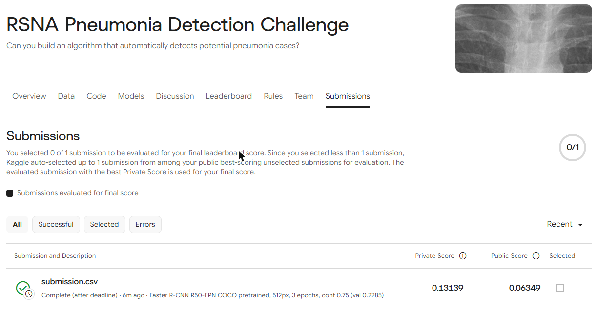

# Leo 版本：Faster R-CNN baseline

RSNA Pneumonia Detection：在胸部 X 光上框出肺炎區域。

## 成績

| 版本 | 自切驗證集 | Kaggle Private | Kaggle Public |
|---|---|---|---|
| baseline（3 epoch） | 0.2285 | 0.13139 | 0.06349 |
| baseline + 框縮成 87.5% | 0.2027 | 0.15278 | 0.07142 |
| full8 第 3 輪 + 框縮成 87.5% | 0.2325（不縮框） | 0.16831 | 0.07936 |
| v1aug2 + v2aug 投票合併，門檻 0.65、縮框 87.5%（參數全部用驗證集決定） | 0.2435（不縮框） | 0.17999 | 0.11111 |
| **同上，門檻 0.55、縮框 86%（這兩個參數看 Kaggle 分數調的）** | — | **0.19516** | 0.11111 |

最後一列的門檻和縮框比例是拿 Kaggle Private 分數挑出來的，等於看過考卷再調參數，所以會比模型真實實力高一點；只用自己驗證集做決定的最好成績是 0.17999。兩個數字都列出來，詳見下面「用 Kaggle 分數調參數」。

（截圖是 baseline 那次）

正式排名看 Kaggle Private。驗證分數 > Private > Public 的順序是合理的：驗證集和訓練資料是同一種標法，信心門檻也是在驗證集上挑的；Public 只用了測試集的一小部分。

### 縮框實驗（`shrink_boxes.py`、`shrink_results.csv`）

參考第 1 名（[i-pan/kaggle-rsna18](https://github.com/i-pan/kaggle-rsna18)，寬高縮成 87.5%）和第 3 名（[pmcheng/rsna-pneumonia](https://github.com/pmcheng/rsna-pneumonia)，每邊縮 17%）的做法，以中心點為準把預測框縮小。

| 縮放比例 | 0.800 | 0.850 | 0.875 | 0.900 | 0.950 | 1.000 |
|---|---|---|---|---|---|---|
| 驗證分數 | 0.1675 | 0.1935 | 0.2027 | 0.2120 | 0.2238 | 0.2285 |

在自己的驗證集上越縮越差，但用第 1 名的 87.5% 上傳後 Kaggle Private 從 0.131 升到 0.153。兩邊結論相反，推測測試集的框標得比訓練資料緊，這也可能是驗證分數和 Kaggle 分數落差大的原因之一。87.5% 是沿用第 1 名的數字，沒有拿 Kaggle 分數去挑比例。

### 訓練輪數實驗（`full8_log.txt`、`full8b_log.txt`）

同一支 `train_baseline.py` 排 8 輪跑了兩次（full8 跑到第 4 輪時電腦記憶體不足被中斷，所以又重跑一次完整 8 輪的 full8b）：

| 輪 | 1 | 2 | 3 | 4 | 5 | 6 | 7 | 8 |
|---|---|---|---|---|---|---|---|---|
| full8 驗證分數 | 0.2175 | 0.2179 | **0.2325** | 0.2244 | – | – | – | – |
| full8b 驗證分數 | 0.2194 | 0.2186 | **0.2280** | 0.2279 | 0.2201 | 0.2272 | 0.2232 | 0.2210 |
| full8b 訓練 loss | 0.0844 | 0.0778 | 0.0750 | 0.0717 | 0.0675 | 0.0640 | 0.0603 | 0.0573 |

兩次都在第 3 輪最好。之後訓練 loss 一路下降、驗證分數卻不再上升，是過擬合：模型越來越會做訓練資料，但沒有變得更會看新的片子，所以多訓練幾輪沒有幫助。兩次第 3 輪差 0.0045，來自隨機性（資料順序、翻轉）。最後採用 full8 第 3 輪的模型。

### 有無肺炎分類器（`classify.py`、`combine.py`、`cls_log.txt`、`combine_results.csv`）

參考第 1 名的做法：另外訓練一個只判斷「整張片子有沒有肺炎」的分類器（ImageNet 預訓練 ResNet50、5 輪、AdamW lr 1e-4），用來過濾健康片子上的誤判框（健康片子畫任何框，那張就是 0 分）。

| 輪 | 1 | 2 | 3 | 4 | 5 |
|---|---|---|---|---|---|
| AUC | 0.8717 | 0.8749 | **0.8831** | 0.8710 | 0.8696 |
| 猜對率 | 83.7% | 84.8% | **84.8%** | 83.8% | 83.3% |

和 full8 的框合併，三種方式在驗證集上比較：

| 方式 | 說明 | 驗證分數 |
|---|---|---|
| none | 不用分類器 | **0.2325** |
| gate g=0.1 | 分類器機率 < 0.1 的片子整張不畫框 | 0.2323 |
| gate g=0.5 | 同上，門檻 0.5 | 0.2015 |
| gate g=0.9 | 同上，門檻 0.9 | 0.0770 |
| geo | 框分數改成 sqrt(框分數 x 分類器機率) | 0.1891 |

分類器沒有幫助，所以沒有上傳。原因是偵測模型本身已經在判斷有沒有肺炎：用它每張圖最高的框分數當「有肺炎的分數」，AUC 是 0.8931、猜對率 84.6%（全猜沒肺炎是 77.5%），比分類器的 0.8831 還高。用比較弱的判斷去否決比較強的判斷，只會把畫對的框也刪掉。第 1 名有效是因為他們的分類器用了多個大模型和更高解析度，明顯強過偵測器；這在 8GB 的筆電顯示卡上做不到。

### 換模型架構：RetinaNet、Faster R-CNN v2（`retina_log.txt`、`v2aug_log.txt`）

`train_baseline.py --arch` 可以選三種模型，都是 torchvision 的 COCO 預訓練權重：

| `--arch` | 模型 | 差別 |
|---|---|---|
| `frcnn`（v1） | Faster R-CNN ResNet50-FPN | 原本的 baseline，兩階段：先找可能有東西的區域，再細看判斷 |
| `frcnn_v2` | Faster R-CNN ResNet50-FPN v2 | 同樣兩階段，但骨幹與偵測頭加了正規化層，COCO 上比 v1 準 |
| `retinanet` | RetinaNet ResNet50-FPN v2 | 一階段，一次對全圖所有位置打分數；用 focal loss 處理「大部分位置都沒病灶」的不平衡 |

RetinaNet 4 輪最好只有 0.1817（第 3 輪），明顯不如 Faster R-CNN。跟 full8 用 NMS 合併（`ensemble.py`）驗證集 0.2355，但 Kaggle Private 0.16740 反而比 full8 單獨低，所以放棄。

### 資料擴增（`v1aug2_log.txt`、`v2aug_log.txt`）

加 `--aug` 後，訓練時除了左右翻轉，還會隨機平移 5%、縮放 85%–115%、調整亮度對比 20%（`transforms.v2`，框座標會跟著一起變，有畫圖確認過）。目的是解決 full8 第 3 輪之後就開始背答案（過擬合）的問題。

| 模型 | 各輪驗證分數 | 最好那輪 + 縮框 87.5% 的 Private / Public |
|---|---|---|
| v1aug2（v1 + 擴增，4 輪，每輪約 25 分鐘） | 0.2093 / 0.2256 / **0.2386** / 0.2333 | 0.16202 / 0.11904 |
| v2aug（v2 + 擴增，4 輪，每輪約 35 分鐘） | 0.2127 / 0.2305 / 0.2314 / **0.2367** | 0.15860 / 0.12698 |

驗證分數和 Public 都比 full8 高很多，但 Private 單獨看都還輸 full8 的 0.16831。

### 投票合併（`vote.py`）

兩個模型的框合在一起時，同一處病灶每個模型拿出自己在那裡最高的分數，取平均當新分數，沒畫框的模型算 0 分。這樣只有一個模型畫的框分數會被拉低，兩個都畫的才容易留下來，比 `ensemble.py` 的 NMS 聯集（直接取兩邊最高分）更保守。

v1aug2 + v2aug 投票，驗證集上最佳門檻 0.65，分數 0.2435（全部實驗中最高），縮框 87.5% 後 **Private 0.17999**，第一次明顯超過 full8。

試過但沒有幫助的：

| 做法 | 結果 |
|---|---|
| 把 full8 也加進投票（三個模型） | 驗證集變差 |
| 加左右翻轉的預測一起投票（翻轉 TTA，`tta.py`） | 驗證集 0.2413，比不加還低 |
| 同架構的兩次訓練結果合併（baseline + full8） | 幾乎沒變 |

### 全資料重訓（`v1aug_full_log.txt`、`v2aug_full_log.txt`）

`--full` 會把驗證集也拿來訓練（多 25% 資料），存最後一輪。v1 跑 3 輪、v2 跑 4 輪（沿用上面最好的輪數）。log 裡的驗證分數因為模型看過這些圖，偏高不能用。

| 合併方式（門檻 0.65、縮框 87.5%） | Private | Public |
|---|---|---|
| 兩個全資料模型投票 | 0.17093 | 0.13492 |
| 原本兩個 + 全資料兩個，四個一起投票 | 0.17523 | 0.11111 |

都輸 0.17999。推測是沒有驗證集就不能挑最好的那一輪，門檻 0.65 也是在舊模型上調的，不一定適合新模型。

### 用 Kaggle 分數調參數（`kaggle_submissions.csv`）

到這裡為止，所有參數都是用自己的驗證集決定的。為了衝分數，最後改用 Kaggle Private 分數直接挑投票門檻和縮框比例（模型不變，都是 v1aug2 + v2aug 投票）：

| 縮框 | 門檻 | Private |
|---|---|---|
| 87.5% | 0.75 / 0.70 / 0.65 / 0.60 | 0.14044 / 0.16182 / 0.17999 / 0.18597 |
| 87.5% | 0.575 / **0.55** / 0.525 / 0.50 | 0.19215 / **0.19457** / 0.19255 / 0.19331 |
| 87.5% | 0.45 / 0.40 | 0.18917 / 0.18357 |
| 80% / 84% / **86%** / 90% / 95% | 0.55 | 0.18818 / 0.19435 / **0.19516** / 0.19266 / 0.18125 |

測試集上的最佳門檻（0.55）比驗證集（0.65）低，代表測試集裡不少肺炎模型其實找到了，只是分數沒那麼高。最高點附近分數很平，再細調只是在追隨機誤差。

在 0.55 / 86% 上又試了幾種組合，都沒有超過 0.19516：

| 做法 | Private |
|---|---|
| 再加翻轉預測一起投票（四份） | 0.19391（門檻 0.5：0.19210、0.6：0.18756） |
| 原本兩個 + v1 全資料，三個投票 | 0.19389 |
| 原本兩個 + v2 全資料，三個投票 | 0.18969 |
| 四個模型投票 | 0.18798（門檻 0.5：0.18817） |
| 兩個全資料模型投票 | 0.18190 |
| 每張圖第一個框和其餘框用不同門檻（8 種組合） | 0.18892–0.19406 |

所有上傳紀錄都在 `kaggle_submissions.csv`。

## 做法

| 步驟 | 內容 | 檔案 |
|---|---|---|
| 前處理 | DICOM（1024x1024）縮成 512x512 PNG；依三種類別（正常 / 不正常但非肺炎 / 肺炎）分層切 80/20 | `preprocess.py` |
| 模型 | torchvision `fasterrcnn_resnet50_fpn`（v1）、`fasterrcnn_resnet50_fpn_v2`、`retinanet_resnet50_fpn_v2`，COCO 預訓練，最後分類層換成 2 類（背景、肺炎） | `train_baseline.py --arch` |
| 資料擴增 | 50% 機率左右翻轉（框座標跟著翻）；`--aug` 再加平移、縮放、亮度對比 | `train_baseline.py` |
| 訓練 | SGD momentum 0.9、lr 0.01、weight decay 1e-4、前 500 步 warmup + cosine、batch 8、混合精度 | `train_baseline.py` |
| 評分 | 照比賽規則：IoU 0.40–0.75 共 8 個門檻的平均 TP/(TP+FP+FN)；每個 epoch 在驗證集上挑最佳信心門檻 | `train_baseline.py` |
| 預測 / 出圖 | 用最佳模型預測 3,000 張測試圖，座標換回 1024 尺度，產生 submission.csv 與報告圖 | `finish.py`、`make_process_figures.py` |
| 提交檔（縮框） | 指定訓練結果和縮框比例產生提交檔 | `make_submission.py` |
| 模型合併 | NMS 聯集、翻轉 TTA、投票合併 | `ensemble.py`、`tta.py`、`vote.py` |

第一版 baseline 原本排 8 個 epoch，因時間只跑 3 個（每個約 25 分鐘），見 `train_log.txt`（之後的 8 輪實驗見上面「訓練輪數實驗」）：

| epoch | 訓練 loss | 驗證分數 | 最佳信心門檻 |
|---|---|---|---|
| 1 | 0.0849 | 0.2146 | 0.60 |
| 2 | 0.0780 | 0.2235 | 0.70 |
| 3 | 0.0751 | 0.2285 | 0.75 |

## 怎麼跑

環境：Windows 11、RTX 4060 Laptop（8GB）、Python 3.12，套件見 `requirements.txt`。

```
kaggle competitions download -c rsna-pneumonia-detection-challenge -p data
tar -xf data/rsna-pneumonia-detection-challenge.zip -C data
python preprocess.py                      # 約 2 分鐘
python train_baseline.py --epochs 8       # 每個 epoch 約 25 分鐘
python finish.py                          # 產生 runs/baseline/submission.csv 與 figures/05、06
python shrink_boxes.py                    # 縮框實驗：驗證集上試 80%–100%
python train_baseline.py --epochs 8 --out runs/full8
python make_submission.py runs/full8 0.875 # 目前最好的提交檔（Private 0.16831）
python classify.py --epochs 5             # 有無肺炎分類器，每輪約 10 分鐘
python combine.py runs/full8 runs/cls 0.875  # 分類器 + 框的三種合併方式比較
python train_baseline.py --arch retinanet --epochs 4 --out runs/retina
python ensemble.py runs/full8 runs/retina 0.875  # NMS 聯集
python train_baseline.py --aug --epochs 4 --out runs/v1aug2                    # 每輪約 25 分鐘
python train_baseline.py --arch frcnn_v2 --aug --epochs 4 --out runs/v2aug     # 每輪約 35 分鐘
python vote.py 0.875 0.65 runs/v1aug2 runs/v2aug  # 只用驗證集決定的版本（Private 0.17999）
python vote.py 0.86 0.55 runs/v1aug2 runs/v2aug   # 用 Kaggle 分數調過的版本（Private 0.19516）
python train_baseline.py --aug --full --epochs 3 --out runs/v1aug_full         # 全資料重訓
python train_baseline.py --arch frcnn_v2 --aug --full --epochs 4 --out runs/v2aug_full
```

長時間訓練建議在自己開的終端機跑，並且接上電源（筆電用電池時顯示卡會降速，分類器第 2 輪因此從 10 分鐘拉長到 42 分鐘）。插電時如果還是很慢，可能是顯示卡過熱自動降速（這台筆電累計約 9.6 小時），把筆電墊高、開最大風扇會比較好。

比賽資料依 Kaggle 規則不能再散布，模型權重（158MB）超過 GitHub 單檔上限，所以這兩樣都沒有放上來，照上面的步驟可以重新產生。

## 報告用圖

| 圖 | 用途 |
|---|---|
| `figures/01_class_distribution.png` | 資料介紹：77.5% 的片子沒有肺炎 |
| `figures/02_box_statistics.png` | 資料介紹：每人框數、框的寬高 |
| `figures/03_samples.png` | 資料介紹：三種類別的 X 光範例 |
| `figures/04_preprocess.png` | 前處理：1024 → 512，框跟著縮 |
| `figures/05_training_curve.png` | 訓練過程 |
| `figures/06_predictions.png` | 錯誤分析：畫準的、漏掉的、健康卻畫框的 |
| `figures/07_kaggle_score.png` | 實驗結果 |

## AI 使用聲明

程式碼與本 README 由 Claude（Anthropic，透過 Claude Code）協助撰寫，每個 `.py` 檔第一行有標註。
